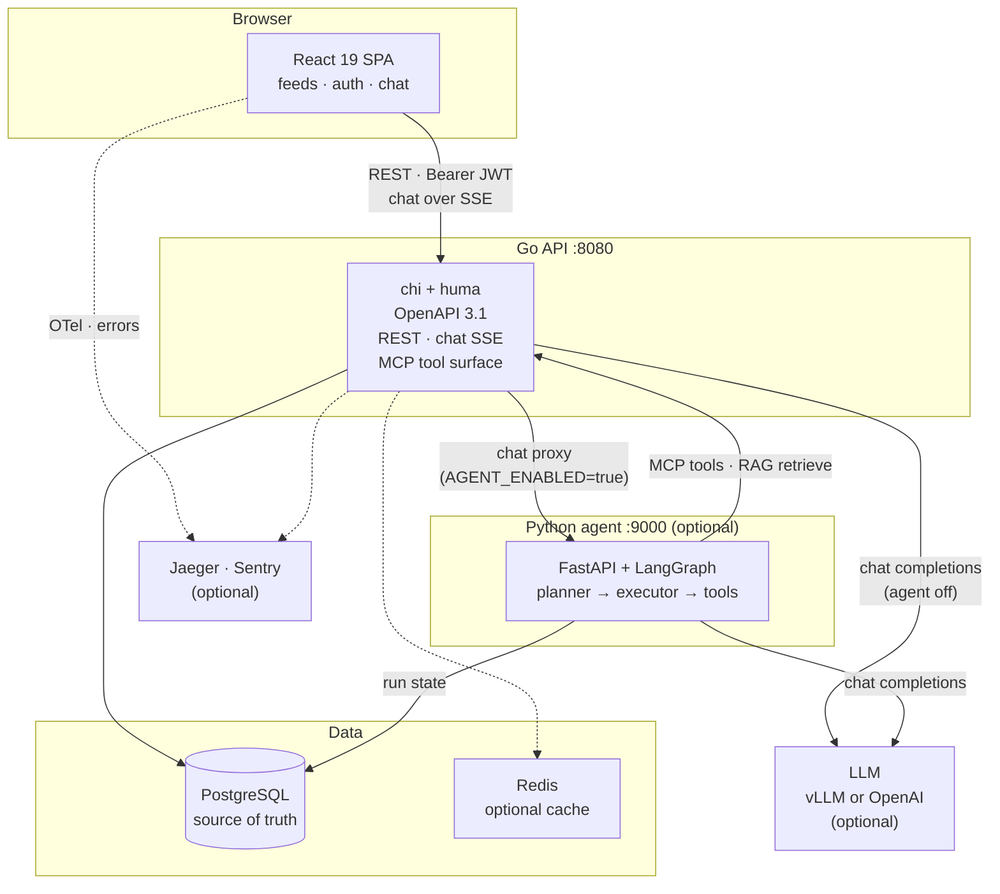

# Nyx

> 🌐 **中文版 / Chinese**: [`README.zh.md`](README.zh.md)
>
> 🤖 **Only here for the agent?** Jump straight to
> [`backend/agent_py/README.md`](backend/agent_py/README.md).

**A feed app with a Plan-and-Execute AI agent growing on top of it.**

The feed app is small and complete: register, log in, manage your own entries — search, sort,
paginate. The agent is where the project is headed at full speed: a Python service that reads
your feed through tools, plans multi-step tasks, executes them step by step, and streams every
plan, tool call, and result into the chat panel.

The app underneath is deliberately built like a production system — typed SQL, rotating auth
tokens, migrations, tracing — because the agent needs an honest substrate to run against: real
data, real auth boundaries, real failure modes.

## Architecture



Solid arrows are request paths, dashed are telemetry / optional extras — the optional pieces are
off by default. Full production topology → [`README_FULL.md` § Architecture](README_FULL.md#architecture).

## The agent

- **Plan-and-Execute loop** — a planner turns your request into typed steps, the executor runs
  them, and the chat UI renders each one as it happens (`plan` → `step_start` → `tool_call` →
  `tool_result` → …) over SSE.
- **Tools** — your feed entries (list / get / create / update / delete via the MCP tool surface),
  semantic search over your own entries (RAG, pgvector), web search, and SSRF-guarded web fetch
  with untrusted-content framing.
- **Built for production** — runs persisted in Postgres (with a stale-run sweeper and retention
  GC), per-user token budget, rate limiting, bounded retries with a partial-failure banner in
  the UI, structured planner output with re-prompts.
- **Observable** — OpenTelemetry spans end-to-end, Prometheus counters, optional Langfuse LLM
  tracing.
- **Any OpenAI-compatible model** — the dev default is a self-hosted vLLM (Qwen3-4B-Instruct);
  OpenAI is a config change away.

## The app underneath

- **Accounts** — JWT access tokens plus rotated refresh tokens with reuse detection.
- **Your feed** — create, edit, delete, search, paginate; every query scoped to your account.
- **Light / dark theme** — the navbar toggle sits beside the `Nyx` brand; until you use it the app
  follows the OS scheme (live), and your pick is stored in `localStorage["nyx.theme"]`
  (`"light"` | `"dark"`; absent = follow the OS) and applied before first paint.
- **Bilingual UI (中文 / English)** — the locale toggle sits beside the theme switch. Every visit
  starts in Chinese, whatever the browser language is; an explicit pick is stored in
  `localStorage["nyx.locale"]` (`"zh"` | `"en"`) and remembered, and `<html lang>` follows the
  active locale.
- **Optional infrastructure**, off by default — Redis cache, Jaeger tracing, Sentry, MCP server.
  (Prometheus `/metrics` is always on.)

## Stack

| Layer | Tech |
|---|---|
| Agent | Python · FastAPI · LangGraph · Postgres checkpointer · pgvector RAG |
| LLM | OpenAI or self-hosted vLLM (identical wire contract) |
| Backend | Go 1.26 · `chi` + `huma` (OpenAPI 3.1) · `sqlc` + `pgx` |
| Frontend | React 19 · Vite · TypeScript · Tailwind v4 · TanStack Query · Zustand |
| Data | PostgreSQL (source of truth) · Redis (optional cache) |
| Ops | Docker Compose (dev) · Kubernetes (prod) · Render + Vercel · GitHub Actions CI |

## Run it

```bash
cp .env.example .env                      # infra
cp backend/.env.example backend/.env      # backend (set AGENT_ENABLED=true for the agent path)
cp frontend/.env.example frontend/.env    # frontend

make up    # Postgres + Redis + Jaeger
make dev   # backend + frontend + agent, one Ctrl+C stops all
```

For real answers the agent needs an LLM — self-host vLLM on a GPU box with:

```bash
make dev-vllm-main    # chat model  (Qwen3-4B-Instruct-2507-FP8, :8000, hermes tool parser)
make dev-vllm-embed   # embeddings  (Qwen3-Embedding-0.6B, :8001, powers RAG)
```

Then open:

- App + chat — <http://localhost:5173>
- API docs — <http://localhost:8080/api/swagger>
- Traces — <http://localhost:16686> (Jaeger) · Langfuse on :3000 via `make dev-up-langfuse`

Chat is gated by `LLM_ENABLED=true`; adding `AGENT_ENABLED=true` routes it through the agent
instead of the plain single-turn RAG chat. The agent path also needs `PYTHON_AGENT_URL` and the
shared `AGENT_SERVICE_TOKEN` (at least 32 bytes, the same value on the Go API and the agent
service — every Go → Python hop carries it as `X-Nyx-Service-Token`). Everything else works the
same either way.

## Deploy

SPA on Vercel, API on Render — the repo carries the config (`render.yaml`,
`frontend/vercel.json`). Two values have to point at each other before the first deploy:

| Where | Var | Value |
|---|---|---|
| Vercel | `VITE_API_URL` | `https://<api>.onrender.com/api` |
| Render | `CORS_ALLOWED_ORIGINS` | `https://<app>.vercel.app` |

`VITE_API_URL` is inlined into the bundle at build time, so changing it needs a new
deploy. Walkthrough, verification commands and the free-tier caveats:
[`docs/deployment.md`](docs/deployment.md).

## Common commands

| Task | Command |
|---|---|
| Backend tests (no Docker) | `cd backend && SKIP_CONTAINERS=true go test ./...` |
| Backend tests (full) | `cd backend && go test ./...` |
| Agent tests | `cd backend/agent_py && .venv/bin/python -m pytest` |
| Frontend tests | `cd frontend && npm test` |
| End-to-end tests | `cd frontend && npm run test:e2e` |
| Stop dev processes | `make stop` |
| Stop infra | `make down` |

## Learn more

- **[`README_FULL.md`](README_FULL.md)** — the full technical README: architecture diagram, auth
  internals, API reference, testing matrix.
- [`FUTURE_AGENT.md`](FUTURE_AGENT.md) — the agent roadmap: what's landed, what's next.
- [`AgentArchitecture.md`](docs_agent/AgentArchitecture.md) — how the agent is put together.
- [`AgentFaultTolerance.md`](docs_agent/AgentFaultTolerance.md) — every failure mode, and what covers it.
- [`backend/agent_py/README.md`](backend/agent_py/README.md) — the Python service in detail.
- [`docs/agent-deployment.md`](docs/agent-deployment.md) — production rollout for the agent.
- [`docs/deployment.md`](docs/deployment.md) — the Render + Vercel deploy path.
- [`CLAUDE.md`](CLAUDE.md) · [`SECURITY.md`](SECURITY.md) · [`FUTURE.md`](FUTURE.md) · [`openspec/`](openspec/)

## License

[PolyForm Noncommercial 1.0.0](LICENSE), with an additional restriction: no use for training,
fine-tuning, evaluating, or developing AI/ML models or systems.

Free for personal, academic, educational, and evaluation use. **Commercial use and AI-training
use are not permitted.** See [`LICENSE`](LICENSE) for the full terms.
