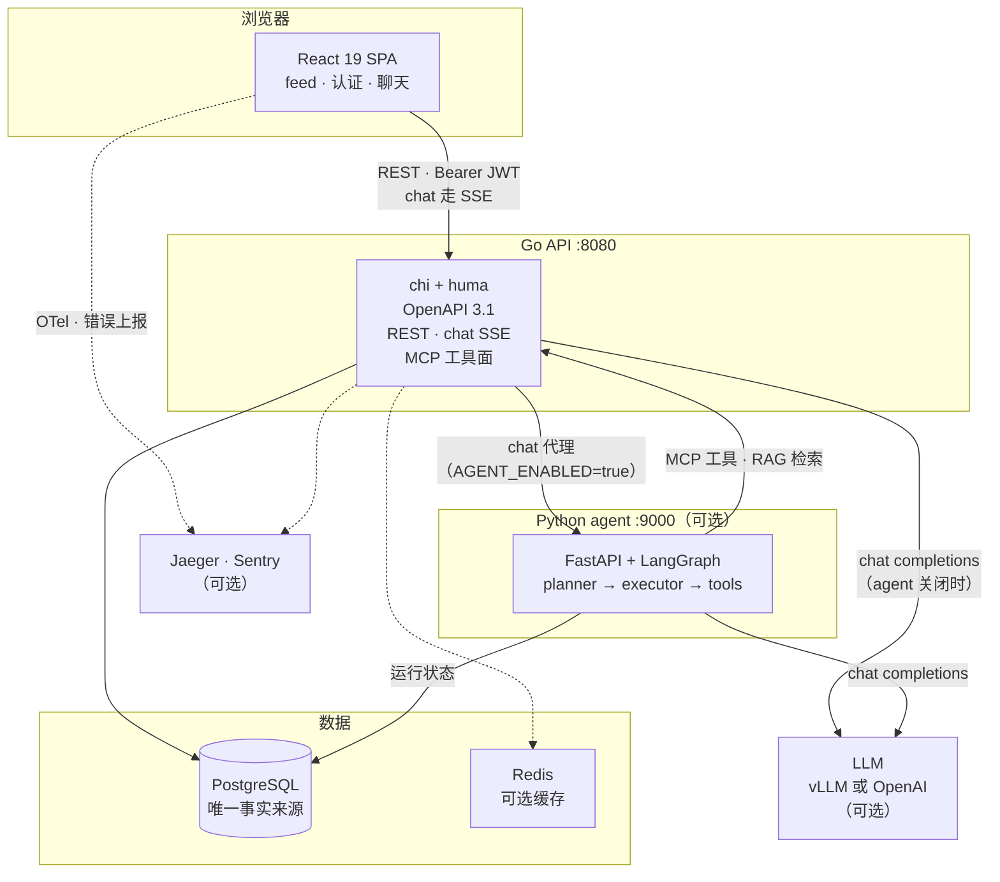

# Nyx

> 🌐 **English version**: [`README.md`](README.md)
>
> 🤖 **只关心 agent？** 直接跳转
> [`backend/agent_py/README.zh.md`](backend/agent_py/README.zh.md)。

**一个 feed 应用，上面长着一个 Plan-and-Execute AI Agent。**

Feed 应用本身小而完整：注册、登录、管理自己的条目 —— 搜索、排序、分页。Agent 则是项目全速推进的方向：一个 Python 服务，通过工具读取你的 feed，规划多步任务，逐步执行，并把每一步计划、每次工具调用及其结果实时流式推送到聊天面板。

底层应用刻意按生产系统的标准搭建 —— 类型安全的 SQL、轮转的 auth token、启动即迁移、链路追踪 —— 因为 agent 需要一个诚实的底座来跑：真实的数据、真实的鉴权边界、真实的故障模式。

## 架构



实线箭头是请求路径，虚线为链路追踪 / 可选项 —— 可选项默认关闭。完整生产拓扑见
[`README_FULL.md` § Architecture](README_FULL.md#architecture)。

## Agent

- **Plan-and-Execute 循环** —— planner 把你的请求拆解成带类型的步骤，executor 逐步执行，聊天 UI 通过 SSE 实时渲染每一步（`plan` → `step_start` → `tool_call` → `tool_result` → …）。
- **工具** —— 你的 feed 条目（通过 MCP 工具面做 list / get / create / update / delete）、对自己条目的语义检索（RAG，pgvector）、web 搜索，以及带 SSRF 防护、按不可信内容封装的 web fetch。
- **按生产标准打造** —— 运行状态持久化在 Postgres（配有 stale-run sweeper 与 retention GC）、每用户 token 预算、限流、有界重试并在 UI 中显示部分失败横幅、结构化 planner 输出配合有界 re-prompt。
- **可观测** —— 端到端 OpenTelemetry span、Prometheus 指标、可选的 Langfuse LLM tracing。
- **任意 OpenAI 兼容模型** —— 开发默认是自托管 vLLM（Qwen3-4B-Instruct）；换成 OpenAI 只需要改配置。

## 底层的 App

- **账号** —— JWT access token，加上带 reuse detection 的轮转 refresh token。
- **你的 feed** —— 创建、编辑、删除、搜索、分页；所有查询都限定在你自己的账号范围内。
- **白天/夜间主题** —— 导航栏切换按钮位于 `Nyx` 字标右侧；未选择前实时跟随系统，选择后记住（`localStorage["nyx.theme"]`，缺省 = 跟随系统）并在首帧前应用（无闪烁）。
- **双语界面（中文 / English）** —— 语言切换按钮位于主题开关旁。每次访问默认中文（不看浏览器语言）；显式选择会存到 `localStorage["nyx.locale"]`（`"zh"` | `"en"`）并长期记住，`<html lang>` 跟随当前语言。
- **可选基础设施**，默认关闭 —— Redis 缓存、Jaeger 链路追踪、Sentry、MCP server。（Prometheus `/metrics` 始终开启。）

## 技术栈

| 层 | 技术 |
|---|---|
| Agent | Python · FastAPI · LangGraph · Postgres checkpointer · pgvector RAG |
| LLM | OpenAI 或自托管 vLLM（wire 协议完全一致） |
| 后端 | Go 1.26 · `chi` + `huma`（OpenAPI 3.1）· `sqlc` + `pgx` |
| 前端 | React 19 · Vite · TypeScript · Tailwind v4 · TanStack Query · Zustand |
| 数据 | PostgreSQL（唯一事实来源）· Redis（可选缓存） |
| 运维 | Docker Compose（开发）· Kubernetes（生产）· Render + Vercel · GitHub Actions CI |

## 跑起来

```bash
cp .env.example .env                      # 基础设施
cp backend/.env.example backend/.env      # 后端（走 agent 路径需设 AGENT_ENABLED=true）
cp frontend/.env.example frontend/.env    # 前端

make up    # Postgres + Redis + Jaeger
make dev   # 后端 + 前端 + agent，一次 Ctrl+C 全部停止
```

要让 agent 真正回答问题，需要一个 LLM —— 在 GPU 机器上自托管 vLLM：

```bash
make dev-vllm-main    # chat 模型  (Qwen3-4B-Instruct-2507-FP8, :8000, hermes tool parser)
make dev-vllm-embed   # 向量模型  (Qwen3-Embedding-0.6B, :8001, 支撑 RAG)
```

然后打开：

- 应用 + 聊天 —— <http://localhost:5173>
- API 文档 —— <http://localhost:8080/api/swagger>
- 链路 —— <http://localhost:16686>（Jaeger）· Langfuse 在 :3000，用 `make dev-up-langfuse` 启动

聊天由 `LLM_ENABLED=true` 开启；再加上 `AGENT_ENABLED=true` 则会路由到 agent，而不是普通的单轮 RAG 聊天。agent 路径还需要 `PYTHON_AGENT_URL` 与共享的 `AGENT_SERVICE_TOKEN`（至少 32 字节，Go API 与 agent 服务必须一致 —— 每次 Go → Python 调用都以 `X-Nyx-Service-Token` 携带）。公网可达的 agent 必须用 `https://` 地址访问；`http://` 只对 loopback 与私网服务名放行。其余一切不受影响。

## 部署

前端 Vercel、后端 Render —— 配置已随仓库提交（`render.yaml`、`frontend/vercel.json`）。
首次部署前，两个变量要互相指向：

| 位置 | 变量 | 值 |
|---|---|---|
| Vercel | `VITE_API_URL` | `https://<api>.onrender.com/api` |
| Render | `CORS_ALLOWED_ORIGINS` | `https://<app>.vercel.app` |

`VITE_API_URL` 在构建时内联进 bundle，改了必须重新部署。完整步骤、验证命令和免费额度的
坑：[`docs/deployment.md`](docs/deployment.md)。

## 常用命令

| 任务 | 命令 |
|---|---|
| 后端测试（无需 Docker） | `cd backend && SKIP_CONTAINERS=true go test ./...` |
| 后端测试（完整） | `cd backend && go test ./...` |
| Agent 测试 | `cd backend/agent_py && .venv/bin/python -m pytest` |
| 前端测试 | `cd frontend && npm test` |
| 端到端测试 | `cd frontend && npm run test:e2e` |
| 停止开发进程 | `make stop` |
| 停止基础设施 | `make down` |

## 深入了解

- **[`README_FULL.md`](README_FULL.md)** —— 完整技术版 README：架构图、auth 内部机制、API 参考、测试矩阵。
- [`FUTURE_AGENT.md`](FUTURE_AGENT.md) —— agent 路线图：已完成什么、下一步做什么。
- [`AgentArchitecture.md`](docs_agent/AgentArchitecture.md) —— agent 的整体设计。
- [`AgentFaultTolerance.md`](docs_agent/AgentFaultTolerance.md) —— 每一个故障面，以及由什么来兜底。
- [`backend/agent_py/README.zh.md`](backend/agent_py/README.zh.md) —— Python 服务详细文档。
- [`docs/agent-deployment.md`](docs/agent-deployment.md) —— agent 的生产上线流程。
- [`docs/deployment.md`](docs/deployment.md) —— Render + Vercel 部署路径。
- [`CLAUDE.md`](CLAUDE.md) · [`SECURITY.md`](SECURITY.md) · [`FUTURE.md`](FUTURE.md) · [`openspec/`](openspec/)

## License

[PolyForm Noncommercial 1.0.0](LICENSE)，附加限制：不得用于训练、微调、评估或开发任何 AI/ML 模型或系统。

个人、学术、教育及评估用途免费。**不允许商业用途，不允许用于 AI 训练。** 完整条款见 [`LICENSE`](LICENSE)。
