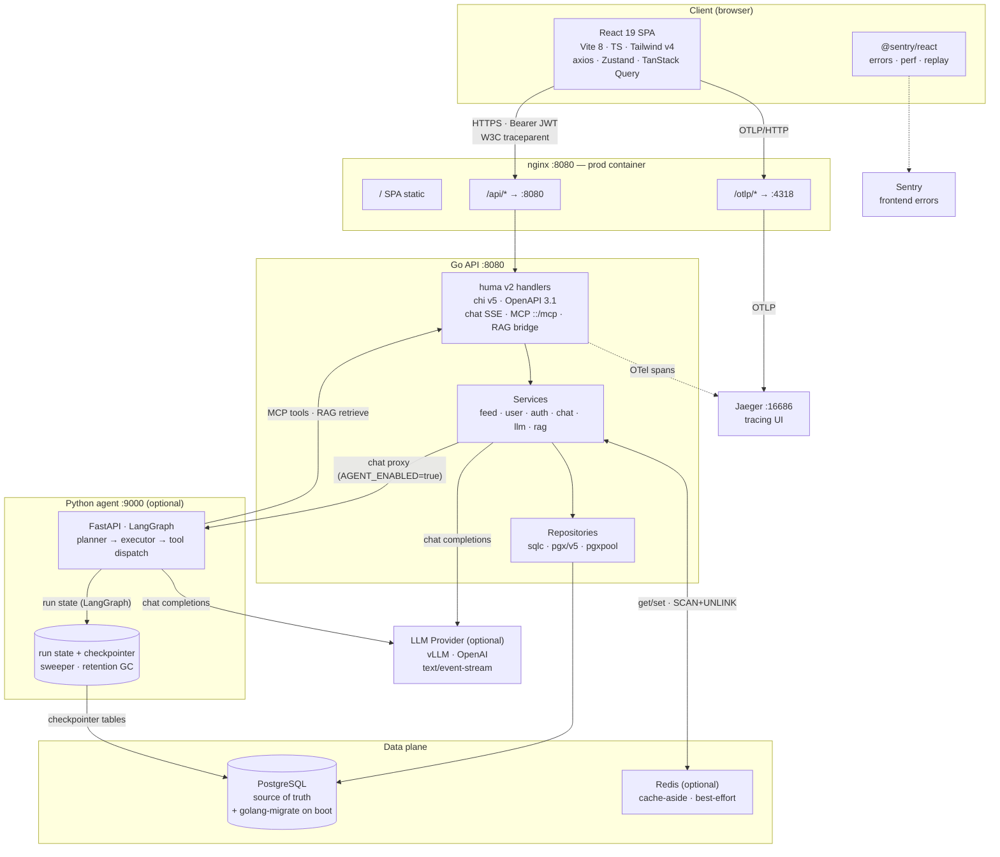

# Nyx

> Full technical README. In a hurry? See the short version: [`README.md`](README.md).

A minimalist feed application — Go 1.26.1 API, React 19 SPA, PostgreSQL, optional Redis cache.

## Highlights

- **Plan-and-Execute agent (the main development focus)** — `backend/agent_py/`, a Python FastAPI + LangGraph service. A planner decomposes each request into typed steps, an executor runs them through tools (feed CRUD via the MCP tool surface, RAG over the caller's own entries, web search + SSRF-guarded web fetch), and the whole run streams to the chat UI as `plan` / `step_start` / `tool_call` / `tool_result` / `step_end` frames. Runs persist in Postgres (checkpointer + stale-run sweeper + retention GC), a per-user token budget and rate limits bound cost, and failures degrade gracefully (bounded tool retries with a partial-failure banner, structured planner output with bounded re-prompts). With `AGENT_ENABLED=true` the Go chat handler is a byte-for-byte SSE proxy to it. See [`FUTURE_AGENT.md`](FUTURE_AGENT.md), [`AgentArchitecture.md`](AgentArchitecture.md), [`AgentFaultTolerance.md`](AgentFaultTolerance.md), [`backend/agent_py/README.md`](backend/agent_py/README.md).
- **Clean-arch backend** — `chi v5` router + `huma v2` for declarative, OpenAPI 3.1-emitting HTTP handlers. SQL is type-safe via `sqlc` + `pgx/v5` + `pgxpool`.
- **Modern frontend** — React 19 + Vite 8 + TypeScript, Tailwind CSS v4, Radix UI primitives (shadcn-style), TanStack Query, Zustand, React Hook Form + Zod, axios.
- **Auth** — JWT access tokens (default 15m) paired with rotated refresh tokens (default 7d, opaque, sha256-hashed, family-level reuse detection). Auth endpoints (`/api/register`, `/api/login`, `/api/refresh`) return `{access_token, refresh_token, token_type: "Bearer", expires_at, user}` in the body; every protected endpoint expects `Authorization: Bearer <access_token>`. `/api/logout` + `/api/refresh` send `{refresh_token}` in the body. Bcrypt-hashed passwords. The SPA stores tokens in a module-level `tokenStore` (in-memory + `sessionStorage`); the Zustand `authStore` persist carries only `user`. Native clients (iOS / Android / Unity / Unreal / console SDKs) speak the identical wire contract — only the token storage differs. Production topology: SPA at `app.nyx.com`, API at `api.nyx.com` (separate Ingress hosts); Bearer is a custom header → CORS preflight = CSRF defence, no token flow needed.
- **Pagination** — `GET /api/feeds` returns `{data, page, page_size, total, has_more}`. Default 20, max 100.
- **Cache-aside** — Redis opt-in for `GET /api/feeds` (`REDIS_ENABLED=true`). Cache is best-effort; failures never fail the request.
- **Observability** — Distributed tracing via OpenTelemetry (browser → nginx → Jaeger, all spans stitched by W3C `traceparent`), `/metrics` (Prometheus: HTTP request count/latency, cache hit/miss), structured JSON logging via `zerolog`, graceful shutdown.
- **CI/CD** — GitHub Actions (lint + unit + integration + sqlc drift + e2e, plus a semantic-release job on push to `main` / `mvp`), `golangci-lint`, `husky` pre-commit + commit-msg hooks on the frontend. Commits are authored via `git cz` (commitizen + cz-customizable) and linted by `@commitlint/config-conventional`; semantic-release per-package versioning drives `backend@X.Y.Z` / `frontend@X.Y.Z` tags from Conventional Commit messages.
- **Deploy** — Kubernetes manifests for production (`k8s/`); Docker Compose (`docker-compose.yml`) is dev-only.

## Architecture

Production topology (Docker Compose / Kubernetes). In dev (`make dev` — backend + frontend + agent), nginx is bypassed — the SPA calls the API directly via `VITE_API_URL` (the browser handles the CORS preflight) and the backend exports traces straight to `localhost:4318`; the frontend OTLP export is same-origin `/otlp/`, which only the nginx container serves (see the OpenTelemetry section).



Solid lines are request paths; dashed lines are telemetry / error reporting. Optional pieces (Redis, LLM, agent, Jaeger, Sentry) are off by default and gated by their `*_ENABLED` flags.

## Repository Layout

```
nyx/
├── backend/              # Go API server
│   ├── cmd/api/          # Entry point (main.go)
│   ├── internal/         # middleware, feed/, user/, chat/, llm/, rag/, mcp/, tool/, platform/, reqctx/
│   ├── agent_py/         # Python agent service (FastAPI + LangGraph + alembic migrations)
│   ├── migrations/       # golang-migrate, applied on every backend boot
│   ├── queries/          # sqlc input (.sql)
│   └── internal/{feed,user}/db/  # sqlc output (regenerated via `make sqlc`)
├── frontend/             # React SPA
│   └── src/
│       ├── features/     # Domain-driven modules (feeds/, auth/, chat/)
│       ├── components/   # Shared UI primitives (Button, Dialog, Card, …)
│       ├── services/     # API client (axios), telemetry, logger
│       ├── store/        # Zustand stores
│       ├── hooks/        # Custom React hooks
│       ├── api/          # Generated OpenAPI client (frontend/src/api/openapi)
│       ├── test/         # Test setup (IntersectionObserver polyfill)
│       └── utils/        # Helpers (cn, etc.)
├── k8s/                  # Deployment, Service, Ingress, Secrets manifests
├── openspec/             # OpenSpec change/spec records
├── AgentArchitecture.md  # agent design · AgentFaultTolerance.md — failure surfaces
├── FUTURE_AGENT.md       # agent roadmap (FUTURE.md / FUTURE_BACKEND.md / FUTURE_FRONTEND.md — other tracks)
├── docker-compose.yml        # Dev stack only — production runs on k8s/
```

## Quick Start (Docker Compose)

```bash
# 1. Configure env. Three files, one per layer — infra at the root,
#    backend under backend/, frontend under frontend/. Each ships an
#    `.env.example` to copy from.
cp .env.example             .env              # infra: POSTGRES_*, HUGGING_FACE_HUB_TOKEN, VLLM_*
cp backend/.env.example     backend/.env     # backend: JWT_SECRET, DB_URL, CORS_ALLOWED_ORIGINS, REDIS_*, OTEL_*, LLM_*
cp frontend/.env.example    frontend/.env    # frontend: VITE_API_URL, VITE_OTEL_*, VITE_SENTRY_DSN

# 2. Build the backend binary locally (Alpine images need a static binary)
(cd backend && CGO_ENABLED=0 go build -o main ./cmd/api)

# 3. Start the stack (db + redis + jaeger). Backend and frontend run
#    locally — see the Local Development section below. To bring them
#    up via compose instead, use `--profile app` (combine with
#    `--profile vllm` to also start the LLM container).
sudo docker compose up --build -d
```

- Frontend: <http://localhost:5173>
- API: <http://localhost:8080/api/feeds>
- API docs (Stoplight Elements): <http://localhost:8080/api/swagger>
- PostgreSQL: `localhost:5433` (mapped from container `5432`)

```bash
# Database
make dev-pgsql-inspect
# manual equivalent: PGPASSWORD=postgres psql -h localhost -p 5433 -U postgres -d nyx

# Redis (if REDIS_ENABLED=true)
make dev-redis-inspect
# manual equivalent: sudo docker compose exec redis redis-cli KEYS 'feeds:*'
```

## Local Development

The repo ships with a root `Makefile` that orchestrates the two halves against the docker-compose infra. From the repo root:

```bash
make up         # docker compose up -d db redis jaeger (idempotent)
make dev-infra  # same infra in the foreground; Ctrl+C stops it
make dev        # backend (go run) + frontend (vite) + Python agent together, Ctrl+C cleans up
make stop   # stop the dev processes
make status # show infra + dev processes
make down   # stop the infra containers
```

`make dev` writes backend output to `/tmp/nyx-backend.log` and frontend to `/tmp/nyx-frontend.log` (tail either independently). It overrides `DB_URL` so the locally-run backend hits the host-mapped `127.0.0.1:5433` rather than the in-network `db:5432` — no `.env` edits needed.

### Backend (manual)

```bash
cd backend
go run ./cmd/api
# Requires DB_URL, JWT_SECRET in env (or backend/.env)
# Add REDIS_ENABLED=true REDIS_URL=redis://localhost:6380 CACHE_TTL=5m for cache
# (6380 = the compose Redis host port)
```

### Frontend (manual)

```bash
cd frontend
npm install
npm run dev
# http://localhost:5173
```

### OpenTelemetry (optional)

Tracing is off by default — both backend (`OTEL_ENABLED`) and frontend (`VITE_OTEL_ENABLED`) gate the SDK behind a `"true"` flag, so a vanilla `npm run dev` carries zero observability overhead.

To turn it on in dev:

```bash
# 1. Start Jaeger (already part of `docker compose up`)
sudo docker compose up jaeger -d

# 2. Backend — env in backend/.env or shell
export OTEL_ENABLED=true
export OTEL_EXPORTER_OTLP_ENDPOINT=http://localhost:4318
cd backend && go run ./cmd/api

# 3. Frontend — Vite inlines these at build time
export VITE_OTEL_ENABLED=true
export VITE_OTEL_SERVICE_NAME=nyx-frontend
cd frontend && npm run dev

# 4. Open the Jaeger UI
open http://localhost:16686
# Service dropdown → "nyx-backend". Click any trace and the tree shows:
#   POST /api/feeds
#   ├── feed.CreateFeed (service span)
#   └── pgx.query (db.operation = INSERT)
```

The browser exporter is **same-origin only** — it posts to `/otlp/v1/traces` on whatever origin serves the SPA, and only the nginx container proxies `/otlp/` through to Jaeger (which sidesteps Jaeger's missing CORS). Browser spans therefore reach Jaeger when the SPA is served by the frontend container (compose `--profile app`); behind bare `npm run dev` there is no `/otlp/` route, so frontend export is a no-op. Backend spans work either way.

In the bundled compose stack, `VITE_OTEL_ENABLED=true` is the frontend container's build default; the backend reads `OTEL_ENABLED` from `backend/.env` (off unless set).

## Self-hosted LLM (vLLM, optional)

The `/api/chat` SSE endpoint streams from any OpenAI-compatible server. The default `openai` provider uses `sashabaranov/go-openai` and targets OpenAI's hosted endpoint or any compatible server via `LLM_BASE_URL`. A second provider — `vllm` — implements the same `llm.Provider` interface against a self-hosted [vLLM](https://docs.vllm.ai/) server with raw `net/http` + a hand-rolled SSE decoder and a per-dial DNS allowlist that the SDK path lacks. Selection happens once at startup via `LLM_PROVIDER={openai,vllm}` (default `openai`).

To run a self-hosted model in dev:

```bash
# Pull a model from HuggingFace (default: Qwen/Qwen3-4B-Instruct-2507).
# HUGGING_FACE_HUB_TOKEN is required in the root .env — HF's CAS
# endpoint demands a token for every weight download, ungated or not.
sudo docker compose --profile vllm up -d

# Add the embedding model (needed for RAG — both the single-turn chat
# path and the agent's semantic search):
sudo docker compose --profile embed up -d

# Watch the vLLM container finish model load — a first cold start can
# take ~10-15 min on WSL2/GPU-PV (cudagraph capture); restarts are quicker.
sudo docker compose logs -f vllm

# Use the chat panel in the SPA, or curl directly:
TOKEN=$(curl -s -X POST http://localhost:8080/api/login \
  -H 'Content-Type: application/json' \
  -d '{"username":"...","password":"..."}' | jq -r .access_token)

curl -N -X POST http://localhost:8080/api/chat \
  -H "Authorization: Bearer $TOKEN" \
  -H 'Content-Type: application/json' \
  -H 'Accept: text/event-stream' \
  -d '{"messages":[{"role":"user","content":"Say hi in one word"}]}'
# Expect: event: delta frames, then event: done with usage, then data: [DONE]
# (single-turn path; with AGENT_ENABLED=true expect plan / step_* frames first)
```

`make dev-vllm-main` / `make dev-vllm-embed` run the same two models on the **host** instead —
a faster dev loop (needs a local vLLM install + GPU). Both the compose service and the host
target configure vLLM's `hermes` tool-call parser, which the agent's planner/executor need in
order to receive tool calls from the Qwen3-Instruct model.

What ships:

- **Image** — `vllm/vllm-openai:v0.29.0` (pinned; bump deliberately).
- **Model cache** — named volume `vllm_cache` persists HuggingFace downloads across `compose down` so multi-GB model weights don't re-pull every restart.
- **GPU** — `deploy.resources.reservations.devices` requests one NVIDIA device. On a host without the NVIDIA container runtime this is silently ignored and vLLM boots in CPU mode (slow but functional for smoke tests).
- **Healthcheck** — `curl -fsS http://localhost:8000/v1/models` with `start_period: 600s` + 60 retries (a 20-min budget to absorb cold load). Larger models may need a higher value.
- **Hardening** — `cap_drop: [ALL]`, `no-new-privileges`, `tmpfs /tmp` (mirrors every other service per `SECURITY.md` M12).
- **Network** — loopback-only host port (`:8000` → `127.0.0.1:8000`) for dev debugging; the backend reaches vLLM on the compose network via the `vllm` DNS alias.

Tuning knobs (all `backend/.env` overrides — the vLLM service itself reads `VLLM_*` from the root `.env`):

| Variable | Default | Purpose |
|---|---|---|
| `LLM_PROVIDER` | `openai` | `openai` (SDK) or `vllm` (raw HTTP) |
| `LLM_BASE_URL` | — (required) | URL of the chat-completions root, e.g. `http://vllm:8000/v1` |
| `LLM_API_KEY` | empty | Bearer token; vLLM without `--api-key` accepts empty |
| `LLM_MODEL` | — (required) | Forwarded as the request `model` field; must match `--served-model-name` |
| `LLM_ALLOW_PRIVATE_URL` | `false` | Set `true` when `LLM_BASE_URL` resolves to a private IP (e.g. the compose vLLM service) |
| `VLLM_MODEL` | `Qwen/Qwen3-4B-Instruct-2507` | HuggingFace repo id passed to `vllm serve --model` |
| `VLLM_EMBED_MODEL` | `Qwen/Qwen3-Embedding-0.6B` | HF repo id for the `embed` profile — 1024-dim vectors feeding RAG |
| `HUGGING_FACE_HUB_TOKEN` | — (required) | Required for **every** vLLM weight download (HF's CAS endpoint demands a token even for ungated models); also needed to access gated ones (Llama, Mistral) |

`LLM_BASE_URL` and `LLM_MODEL` have no defaults — the backend refuses to start with `LLM_ENABLED=true` until both are set. Gated-model caveat: on top of the always-required token, Llama / Mistral / Gemma additionally need (a) a HuggingFace account and (b) accepting the model's license on the model card — otherwise vLLM fails the download with `403 Forbidden`.

CPU caveat: a Qwen3-4B smoke test on CPU runs at a few tokens/sec after cold load — fine for "does it work?" verification, not a usable dev experience. For real iteration, run vLLM on a GPU host (or switch to a smaller model).

Safety: `LLM_BASE_URL` is validated at startup (scheme allowlist http/https, no userinfo, host refuses loopback / RFC1918 / link-local / multicast / unspecified unless `LLM_ALLOW_PRIVATE_URL=true`). The vLLM provider repeats the IP-class check inside its `http.Transport.DialContext` so DNS rebinding can't swap a public hostname's answer for a private IP between startup and the first dial. See `SECURITY.md` for the residual risk on the OpenAI provider path.

## The agent (Plan-and-Execute)

The project's main development focus. `backend/agent_py/` is a FastAPI + LangGraph service that
turns `/api/chat` into an agent run: a **planner** decomposes the request into typed steps, an
**executor** runs them, and **tool dispatch** calls out through the existing surfaces. With
`AGENT_ENABLED=true` the Go chat handler becomes a thin SSE proxy to it (`PYTHON_AGENT_URL`;
`make dev` and compose point it at the agent service). The transport is the existing
`text/event-stream`; the frame kinds are `run_id` (opens every fresh run — echo it to resume),
`plan`, `step_start`, `tool_call`, `tool_result`, `step_end`, `delta`, `done`, `note`, `error`,
and `terminator`. The SPA chat panel renders the intermediate steps plus a partial-failure
banner when a tool fails for good.

Tools:

| Tool | Surface |
|---|---|
| Feed CRUD (`list` / `get` / `create` / `update` / `delete`) | the existing MCP endpoint (`POST /mcp`, JWT bearer) |
| Semantic search over the caller's own feeds (RAG) | Go-side pgvector retrieval via `GET /internal/rag/retrieve` (JWT bearer) |
| `web_search` | Tavily Search API |
| `web_fetch` | SSRF-guarded fetch — per-dial private-IP refusal, redirect cap, byte/char caps, content-type allowlist — with results framed as untrusted content |

The web tools are gated by `web_search_enabled` / `web_fetch_enabled` in the service's settings.

Reliability and state: runs are persisted with the LangGraph Postgres checkpointer (alembic
migrations; under compose a one-shot `agent-migrate` service runs them), heartbeated, swept when
stale, and garbage-collected by a retention job. A per-user token budget bounds cost, and the
hot path is rate-limited. Tool-dispatch failures retry a bounded number of times, then surface
as a banner in the UI rather than a dead stream; planner output is obtained as structured JSON
with bounded re-prompts. Every failure surface is catalogued in `AgentFaultTolerance.md`.

Observability: `agent.run` / `agent.step.*` OTel spans ride the existing trace pipeline; the
service exposes Prometheus counters (`agent_runs_total`, `agent_steps_total`,
`agent_tool_calls_total`, `agent_tokens_total`, …) on `/metrics`; Langfuse LLM tracing is
opt-in (`make up-langfuse`, UI on <http://localhost:3000>).

Run it in dev:

```bash
make dev-vllm-main    # chat model on the host — Qwen3-4B-Instruct-2507-FP8, :8000, hermes tool parser
make dev-vllm-embed   # embedding model on the host — Qwen3-Embedding-0.6B, :8001 (RAG)
make dev              # backend + frontend + agent (the agent service always starts under `make dev`; AGENT_ENABLED gates whether the Go backend proxies chat to it)
```

The service's own keys (`PYTHON_AGENT_*` — model endpoints, run-state/retention/sweeper
settings, tool toggles) are documented in `backend/agent_py/.env.example` and
`backend/agent_py/README.md`; production rollout order is in `docs/agent-deployment.md`.
Design deep dives: `AgentArchitecture.md` and `FUTURE_AGENT.md`.

## Testing

| Layer | Command | Notes |
|---|---|---|
| Backend unit | `cd backend && SKIP_CONTAINERS=true go test ./...` | No Docker needed |
| Backend full | `cd backend && go test ./...` | Needs Docker for testcontainers |
| Backend lint | `cd backend && golangci-lint run --timeout=5m` | |
| Backend sqlc drift | `cd backend && make sqlc-diff` | Verifies generated code is in sync |
| Agent (Python) | `cd backend/agent_py && .venv/bin/python -m pytest` | pytest + pytest-asyncio, see `pyproject.toml` |
| Frontend unit | `cd frontend && npm test` | Vitest + React Testing Library |
| Frontend lint | `cd frontend && npm run lint` | |
| Frontend build | `cd frontend && npm run build` | |
| E2E | `cd frontend && npm run test:e2e` | Playwright, needs backend running |

## Production (Kubernetes)

```bash
cp k8s/secrets.yaml.example k8s/secrets.yaml   # edit with base64-encoded secrets
kubectl apply -f k8s/
```

See `k8s/*.yaml` for per-resource config.

## API Endpoints

| Method | Path | Auth | Notes |
|---|---|---|---|
| GET | `/api/health` | — | Deep readiness (DB + cache status) |
| GET | `/api/livez` | — | Shallow liveness — 200 while the process is up |
| POST | `/api/register` | — | Body `{username, password}`. Returns `{access_token, refresh_token, token_type: "Bearer", expires_at, user}` |
| POST | `/api/login` | — | Body `{username, password}`. Returns the Bearer pair + user |
| POST | `/api/refresh` | — | Body `{refresh_token}`. Returns a fresh Bearer pair + user. Reuse revokes the entire family |
| POST | `/api/logout` | Bearer | Body `{refresh_token}`. Revokes only that row. Returns 204 |
| GET | `/api/me` | Bearer | Access-token subject's profile — the SPA calls it on every page load |
| GET | `/api/feeds` | JWT | Lists feeds **owned by the caller**; `?q=`, `?page=`, `?page_size=` |
| GET | `/api/feeds/{id}` | JWT | Single feed; 404 for missing *or* other users' — no existence leak |
| POST | `/api/feeds` | JWT | |
| PUT | `/api/feeds/{id}` | JWT | |
| DELETE | `/api/feeds/{id}` | JWT | Soft-delete |
| POST | `/api/chat` | JWT | SSE (`text/event-stream`). Requires `LLM_ENABLED=true`. Single-turn RAG chat, or an SSE proxy to the Python agent when `AGENT_ENABLED=true` |
| POST | `/mcp` | JWT | MCP Streamable HTTP exposing the feed tools (`MCP_ENABLED=true`) |
| GET | `/internal/rag/retrieve` | JWT | RAG bridge consumed by the Python agent |

Full schema: `http://localhost:8080/api/swagger/doc.json` (interactive docs at `/api/swagger`).
The same spec is committed at `api/openapi.json` and regenerated offline with
`cd backend && make openapi`; CI runs `make openapi-diff` to catch drift.

## Conventions

- **Commits** — Conventional Commits (`feat:`, `fix:`, `refactor:`, `docs:`, `test:`, `chore:`).
  - Author via `git cz` (alias set up by `npm install`; runs commitizen + cz-customizable interactively). Plain `git commit -m` is also fine — the `.husky/commit-msg` hook runs `commitlint --edit` on the message file and rejects anything that doesn't match the schema.
  - Allowed scopes (kept in sync between `.cz-config.cjs` and `commitlint.config.js`): `backend`, `frontend`, `auth`, `infra`, `mcp`, `security`, `ci`, `docs`, `claude`, `env`, `observability`, `data`, `repo`.
  - Per-package releases: `semantic-release` (monorepo plugin) computes `backend@X.Y.Z` / `frontend@X.Y.Z` independently from commit paths, writes per-package `CHANGELOG.md`, stamps the new version into `ServiceVersion` + `frontend/package.json`, and pushes the release commit + tags. No npm publish.
- **Errors** — domain sentinels (`feed.ErrNotFound`, `user.ErrInvalidCredentials`, `user.ErrUsernameTaken` / `ErrRefreshTokenCollision` translated from `pgconn.PgError` by `internal/platform/pgerr`, `auth.ErrInvalidToken`, …). Handlers funnel every error through `api.MapError(ctx, err, "Failed to <op>")` — unknown errors reuse `ClassifyAndLog` so internal error text never reaches the wire. Never string-compare error messages.
- **Cache** — best-effort. Mutations call `DeletePrefix("feeds:")` (SCAN + UNLINK, non-blocking).
- **Migrations** — `backend/migrations/00000N_description.{up,down}.sql`. Applied on every backend boot.

## Roadmap

See `FUTURE.md`, `FUTURE_AGENT.md` (the agent track — the project's main focus),
`FUTURE_BACKEND.md`, `FUTURE_FRONTEND.md`. Tick an item when the work lands.

## License

[PolyForm Noncommercial License 1.0.0](LICENSE), with an additional restriction prohibiting use of this software for training, fine-tuning, evaluating, or developing any AI/ML model or system.

Free for personal, academic, educational, and evaluation use. **Commercial use and AI training use are not permitted.** See [`LICENSE`](LICENSE) for the full terms.
