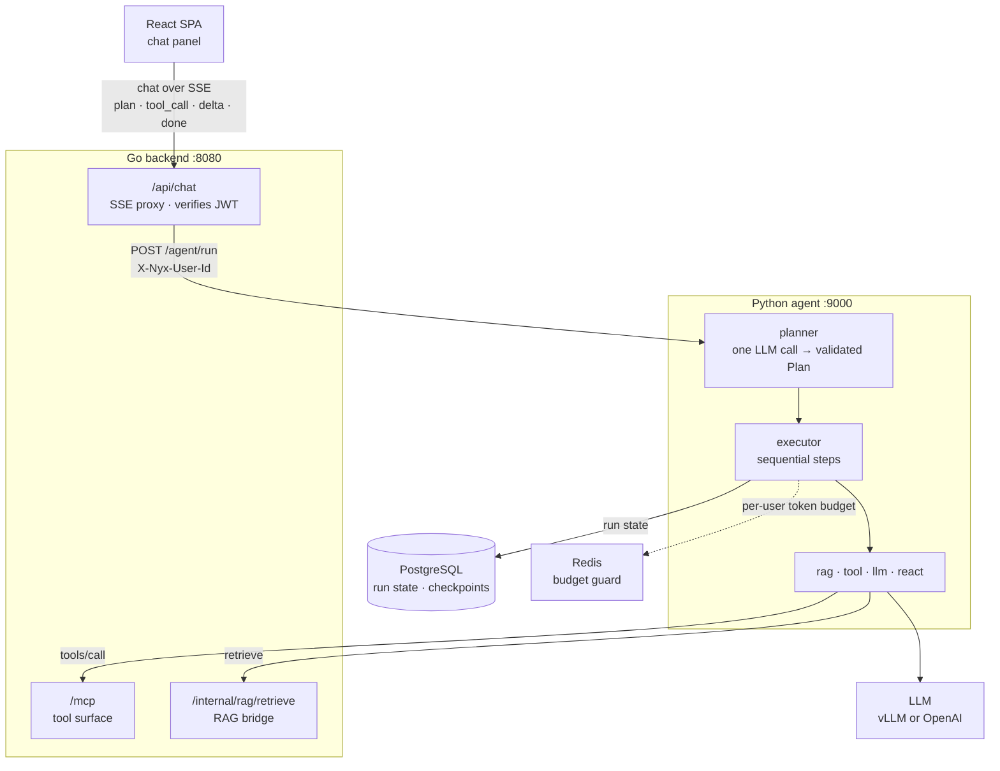

# nyx-agent

> 🌐 **中文版 / Chinese**: [`README.zh.md`](README.zh.md)

**Nyx's Python Plan-and-Execute agent service.** It turns a chat request into a typed plan, runs
the steps with tools, and streams every plan / tool call / result back to the chat UI over SSE —
byte-for-byte the same wire contract the Go chat handler speaks.



## What it does

- **Plan-and-Execute** — the planner makes one LLM call (provider structured output, validated
  by Pydantic, with a bounded re-prompt on failure), then the executor runs the steps in order.
- **Write routing** — state-change requests must plan the matching write tool; a composing `llm`
  step precedes the write and its id is referenced from the write args. Draft/preview/negation
  requests do not plan a write. The deterministic guard's lexical triggers are Chinese-only in this
  change, and it covers only the structured planner path; the legacy free-text path has no retry.
- **Step kinds** — `rag` (your feed via the Go RAG bridge), `tool` (the MCP tool surface),
  `llm` (single call), `react` (nested model ↔ tool loop, iteration-capped).
- **Robust by default** — bounded retries on both tool-dispatch failure classes (validator
  re-prompt / transient backoff), per-user Redis token budget (fail-closed), per-IP rate limit,
  run state in Postgres with resume-by-`run_id`, stale-run sweeper + retention GC.
- **Observable** — Prometheus counters (:9001), OpenTelemetry spans (Jaeger), optional
  Langfuse LLM tracing, and process logging configured at boot (root at WARNING, the
  agent's own loggers — the `agent` package and the `nyx.agent.*` runtime tree — at INFO,
  `timestamp level logger: message` lines) so tracing state, startup lines, and export
  failures are visible in the default log output.
- **Optional web tools, off by default** — agent-native `web_search` (Tavily, keyless tier
  works with no account) and SSRF-guarded `web_fetch` with untrusted-content framing.
- **Feed tools with confirmation** — the planner sees the live MCP registry (feed CRUD);
  non-read-only calls pause the run on an in-chat approve/deny card (`confirm_request`).
- **Memory** — every session and message is persisted (1-year retention floor, soft-delete +
  grace); the planner and the executor get a cross-session "Known user preferences" block;
  sessions title themselves from the first exchange (deterministic 48-char label, then one
  fire-and-forget refinement call); the subject-facing surfaces are owner-scoped:
  `/agent/sessions*` (history sidebar API) and GDPR export/erasure (`/agent/me/*`) with a
  counts-only audit log.

## Endpoints

- `POST /agent/run` — `{messages, agent?, model?, run_id?}` in, SSE out (`plan`, `step_start`,
  `tool_call`, `tool_result`, `step_end`, `delta`, `done`, `note`, `error`, `terminator`,
  `confirm_request`).
- `POST /agent/approvals` — `{run_id, approval_id, decision}`; records an approve/deny for a
  paused mutating-call confirmation (see the `confirm_request` frame). Owner-scoped via
  `X-Nyx-User-Id`.
- `GET|POST|DELETE /agent/sessions*` — history sidebar API (list / replay / create / resume /
  delete), owner-scoped via `X-Nyx-User-Id`.
- `GET /agent/me/export` · `DELETE /agent/me` — GDPR subject export + right-to-erasure
  (idempotent, physical delete incl. langGraph threads, counts-only audit trail);
  `PYTHON_AGENT_GDPR_ENABLED=false` → 503 on both.
- `GET /healthz` — `200 {"status":"ok"}` when Redis is reachable; 503 otherwise.
- `GET /metrics` — Prometheus counters on :9001.

## Run locally

Normally started for you by `make dev` from the repo root (set `AGENT_ENABLED=true`). To run it
standalone:

```bash
cd backend/agent_py
cp .env.example .env        # fill in PYTHON_AGENT_LLM_BASE_URL + PYTHON_AGENT_LLM_API_KEY
uv sync --locked --extra dev
python -m agent.main        # or: uvicorn agent.main:app --port 9000 --reload
```

Needs Postgres (alembic migrations run on boot) and Redis (budget guard — unreachable Redis
fails runs closed). In compose, the `agent` service builds from this directory (the `app`
profile).

## Dependency lock

`uv.lock` is committed and pins every package. After editing `pyproject.toml`, run `uv lock` and
commit the result; installs use `--locked`, so a stale lock fails instead of silently resolving
fresh.

## Tests

```bash
cd backend/agent_py && pytest tests/ -v
```

## Dependency audit

`uv sync --locked --extra ci` adds `pip-audit`. CI runs it on every change under
`backend/agent_py/**` through `scripts/ci/pip_audit_with_allowlist.py`, which
applies `.pip-audit-allowlist.toml` (one dated, rationale-carrying entry per
deferred advisory; entries expire after 90 days):

```bash
cd backend/agent_py && PATH="$PWD/.venv/bin:$PATH" python3 ../../scripts/ci/pip_audit_with_allowlist.py
```

`fakeredis` + `httpx.MockTransport` — no live network needed.

## Key env vars

Boot-critical:

| Env var | Default | Purpose |
|---|---|---|
| `PYTHON_AGENT_LLM_BASE_URL` / `_API_KEY` / `_MODEL` | OpenAI / `gpt-4o-mini` | Any OpenAI-compatible endpoint (dev default is vLLM) |
| `PYTHON_AGENT_DATABASE_URL` | — | Postgres: `agent.runs` + langGraph checkpoints (alembic on boot) |
| `PYTHON_AGENT_REDIS_URL` | `redis://localhost:6380` | Per-user budget guard |
| `PYTHON_AGENT_MCP_URL` / `RAG_BRIDGE_URL` | `:8080` host-dev | Go tool surface + RAG bridge |
| `AGENT_BUDGET_PER_USER_PER_HOUR` | `200000` | Tokens/user/hour (unprefixed — shared cross-runtime contract) |

Common flags:

| Env var | Default | Purpose |
|---|---|---|
| `PYTHON_AGENT_PLANNER_STRUCTURED_ENABLED` | `true` | `false` → legacy free-text plan parsing |
| `PYTHON_AGENT_TOOL_RETRY_MAX` | `2` | Retries per tool call (validator + transient paths) |
| `PYTHON_AGENT_WEB_FETCH_ENABLED` / `WEB_SEARCH_ENABLED` | `false` | Agent-native web tools; search runs keyless without `TAVILY_API_KEY` |
| `PYTHON_AGENT_SWEEP_ENABLED` | `true` | Stale-run reaper kill switch |
| `PYTHON_AGENT_LANGFUSE_ENABLED` | `false` | LLM-level traces to a Langfuse instance |
| `PYTHON_AGENT_APPROVAL_TTL_SECONDS` | `300` | Wall-clock window a mutating-call confirmation stays open before it closes as denied |
| `PYTHON_AGENT_CHAT_RETENTION_DAYS` / `…_GRACE_DAYS` | `365` / `7` | Chat-history retention (floor 365 days) + soft-delete grace |
| `PYTHON_AGENT_PREFS_ENABLED` | `true` | Preference extraction + planner-injection kill switch |
| `PYTHON_AGENT_GDPR_ENABLED` | `true` | GDPR export/erase kill switch (503, touches nothing) |
| `LANGFUSE_DEBUG` | unset | Langfuse SDK verbose mode — read from the **process environment** (see below) |

Langfuse tracing is diagnosable from the default logs: with `PYTHON_AGENT_LANGFUSE_ENABLED=true`
the boot line names the configured host, and a failing export surfaces the OTel exporter's
retry/drop diagnostic (best-effort delivery — the run itself is unaffected). For SDK-level verbose
output set `LANGFUSE_DEBUG=true` in the **process environment** (shell, compose `environment:`,
systemd unit): the Langfuse SDK reads `os.environ`, and the agent's `.env` is loaded by
pydantic-settings without being mirrored into it — a `.env` entry alone has no effect.

Every knob, default, and rationale → [`README_ALL.md`](README_ALL.md).

## Trust model

The service does **not** verify JWTs. It runs on the private compose / k8s network — port 9000
is not published, only `127.0.0.1:9001` for metrics. Go's chat handler verifies the user JWT
and forwards the verified user id in `X-Nyx-User-Id`; the bearer token is a passthrough that Go
re-verifies at `/mcp` and the RAG bridge. An in-process per-IP rate limit on `/agent/run`
(`PYTHON_AGENT_REQUESTS_PER_SECOND` 100 / `BURST` 200) backstops a compromised container — it
is **not** an auth layer. If port 9000 ever becomes reachable beyond this network, add one
(mTLS / shared secret / firewall). Full rationale → [`README_ALL.md` § Trust model](README_ALL.md#trust-model).

## Learn more

- [`README_ALL.md`](README_ALL.md) — the full reference: planner + tool-retry internals,
  prior-data context bounding, sweeper + retention, Langfuse, complete env tables, incidents.
- [`FUTURE_AGENT.md`](../../FUTURE_AGENT.md) — roadmap; [`docs/agent-deployment.md`](../../docs/agent-deployment.md) — production rollout.
- `openspec/changes/` — the change proposals behind each behavior.

## Golden Set Eval Suite

The planner is probabilistic, so its regressions show up as **rates**, not single verdicts. `evals/` at the
repo root holds a promptfoo-based suite that drives the production chat path (`POST /agent/run`, real SSE)
as a per-run eval user and grades with deterministic assertions — no LLM judge.

- `make eval-golden` — the main regression line (`evals/cases/main.yaml`); `make eval-security` — the
  injection line (`evals/cases/security.yaml`), tracked separately. Both run serially (one 4B model), never
  start services, and preflight the stack — a down stack stops with a message naming the URL it tried.
- Defaults target the side stack (`./scripts/e2e-side-stack.sh up` → Go `:8180`, agent `:9100`; override with
  `EVAL_GO_API_URL` / `EVAL_AGENT_URL`). Match `EVAL_WEB_SEARCH` (`on`/`off`) to the running agent's
  `PYTHON_AGENT_WEB_SEARCH_ENABLED` — the weather case is the tripwire. Cases whose prerequisites are absent
  (`requires: budget_stack`) report **SKIPPED** with a reason and never count as passes.
- Results land in `evals/artifacts/<UTC-stamp>/`: `report.json`, `summary.md`, per-sample raw SSE and
  transcripts. Artifacts are gitignored in bulk; the landing baseline report is committed as evidence.
- `EVAL_FILTER=<regex>` narrows a run to matching cases (diagnostics only: the exit code then covers
  just the sampled cases — run the unfiltered line before trusting a green).
- Unit gate (no model, no network): `backend/agent_py/.venv/bin/python -m pytest evals/tests -q` from the
  repo root. The `agent-lint` CI job runs it from the repo root under the agent venv
  (`uv sync --locked --extra dev`), and its path filter covers `evals/**`, so a grader, corpus-validation,
  or transcript-parsing change fails the pull request. It never calls the model — answer and plan quality
  still require a live `make eval-golden` run.
- Harness internals (provider contract, corpus schema, grading semantics) → the change spec at
  `openspec/changes/archive/2026-10-16-agent-golden-eval/specs/agent-golden-eval/spec.md`. promptfoo is pinned in the Makefile
  (`EVAL_PROMPTFOO_VERSION`).
- Web-shaped cases should run against the bundled Tavily stub (`evals/stubs/tavily_stub.py`), not the live
  search API: point the eval stack at it with `PYTHON_AGENT_TAVILY_BASE_URL=http://127.0.0.1:8899/search`
  (+ `PYTHON_AGENT_WEB_SEARCH_ENABLED=true`). The stub serves the hostile payloads the security line keys
  on and a canned result set for everything else; the keyless Tavily tier IP-rate-limits after a handful of
  runs and stalls web samples for minutes, which is external noise in a rate.

### Manual live-run runbook

Run before a release and after any planner / executor / tool / prompt change. The suite is serial by
contract: one 4B vLLM serves every sample (`make eval-golden` pins `--max-concurrency 1`; the live
Playwright set pins `--workers=1`). Never run two live suites against the same model concurrently.

1. **Infra.** `make up` starts Postgres `:5433`, Redis `:6380`, and Jaeger `:16686`.
2. **Models.** In separate terminals run `make dev-vllm-main` (chat `:8000`) and `make dev-vllm-embed`
   (embeddings `:8001`), then wait for `curl -fsS http://localhost:8000/v1/models` and
   `curl -fsS http://localhost:8001/v1/models`. Do not race the cold start.
3. **Tavily stub.** `backend/agent_py/.venv/bin/python evals/stubs/tavily_stub.py --port 8899 &`, then
   export `PYTHON_AGENT_WEB_SEARCH_ENABLED=true` and
   `PYTHON_AGENT_TAVILY_BASE_URL=http://127.0.0.1:8899/search` before starting the side stack.
4. **Side stack.** `./scripts/e2e-side-stack.sh up`; defaults are Go `:8180`, agent `:9100`. Check Go
   `/api/feeds` returns `401` (up and protected), agent `/healthz` returns `{"status":"ok"}`, and curl the
   embedding endpoint yourself. For a second stack set `E2E_STACK_SUFFIX` and spare
   `E2E_GO_PORT` / `E2E_AGENT_PORT` / `E2E_AGENT_METRICS_PORT` / `E2E_VITE_PORT`.
5. **Main line.** `EVAL_WEB_SEARCH=on make eval-golden`; run `make eval-security` on the same stack.
6. **Budget line.** Start a second stack with a tiny cap, then run only the budget case:
   `AGENT_BUDGET_PER_USER_PER_HOUR=500 E2E_STACK_SUFFIX=-budget E2E_GO_PORT=8280 E2E_AGENT_PORT=9200 E2E_AGENT_METRICS_PORT=9201 ./scripts/e2e-side-stack.sh up`
   then
   `EVAL_GO_API_URL=http://localhost:8280 EVAL_AGENT_URL=http://localhost:9200 EVAL_BUDGET_STACK=1 EVAL_FILTER=main-budget-exceeded make eval-golden`.
   The filtered run's overall rate is not a suite baseline.
7. **Read the artifacts.** `evals/artifacts/<UTC-stamp>/summary.md` carries the per-case rates, the
   applied floor and its baseline provenance, the SKIPPED set, and the answer-coverage marking. A run with
   NOT RUN cases is labeled `PARTIAL RUN (not a baseline)`; do not cite its overall rate as a suite
   baseline. To land a baseline, force-add only `report.json` and `summary.md`.
8. **Cleanup.** Stop only the stacks you started (`E2E_STACK_SUFFIX=-budget ./scripts/e2e-side-stack.sh stop`,
   then `./scripts/e2e-side-stack.sh stop`); `make stop` if you started the host vLLM targets.

Known reds at this slice, not new regressions: `main-rag-update-feed` / `main-rag-delete-feed` are recorded
red pending `agent-feed-bulk-write-tools`; `main-web-force-search` is deferred to slice 2;
`main-budget-exceeded` is SKIPPED on the normal stack by design.
