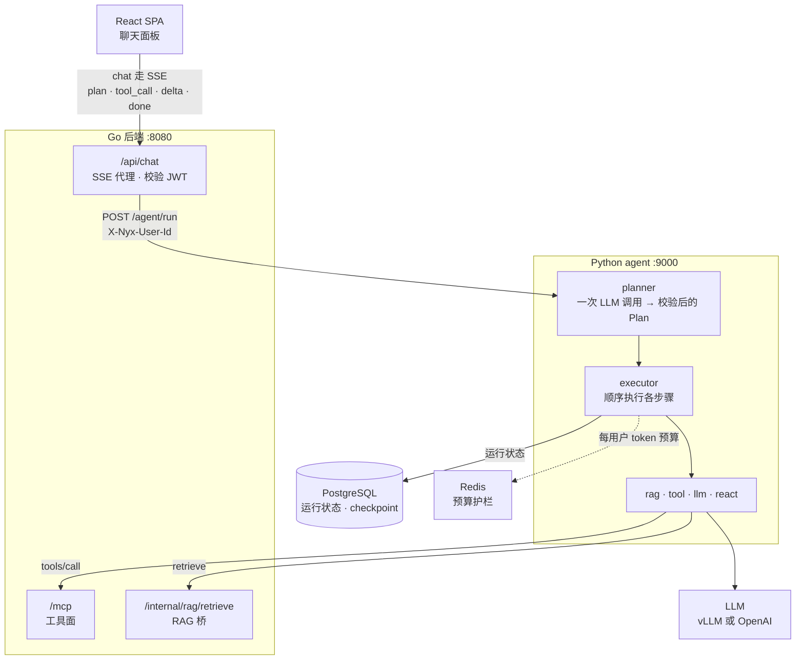

# nyx-agent

> 🌐 **English version**: [`README.md`](README.md)

**Nyx 的 Python Plan-and-Execute agent 服务。** 它把一次聊天请求变成类型化的执行计划，用工具逐步执行，并把每一步计划 / 每次工具调用 / 每个结果通过 SSE 实时推回聊天界面 —— 与 Go chat handler 的线上契约逐字节一致。



## 它做什么

- **Plan-and-Execute** —— planner 只做一次 LLM 调用（走 provider 结构化输出，Pydantic 校验，校验失败时有界重试），executor 然后按顺序执行各步骤。
- **写路由** —— 状态变更请求必须规划对应的写工具；写操作前先有组稿 `llm` 步，写参数引用该步输出。草稿/预览/否定请求不规划写操作。本变更里的确定性 guard 词法触发仅覆盖中文，且只覆盖 structured planner 路径；legacy 自由文本路径没有重试。
- **步骤类型** —— `rag`（通过 Go RAG 桥读取你的 feed）、`tool`（MCP 工具面）、`llm`（单次调用）、`react`（模型 ↔ 工具嵌套循环，有迭代上限）。
- **默认就稳** —— 工具分发两类失败均有有界重试（校验失败重新提示 / 瞬时错误退避重试）、每用户 Redis token 预算（fail-closed）、按 IP 限流、运行状态存 Postgres 支持 `run_id` 恢复、僵尸运行清扫 + 保留期 GC。
- **可观测** —— Prometheus 指标（:9001）、OpenTelemetry 链路（Jaeger）、可选 Langfuse LLM 追踪，以及启动时配置好的进程日志（root 为 WARNING，agent 自身的 logger —— `agent` 包与 `nyx.agent.*` 运行时树 —— 为 INFO，行格式 `时间 级别 logger: 消息`）：追踪状态、启动行与导出失败在默认日志里就可见。
- **可选 web 工具，默认关闭** —— agent 原生的 `web_search`（Tavily，无账号也可用 keyless 档）和带 SSRF 防护、非受信内容框定的 `web_fetch`。
- **记忆** —— 每个会话与消息都会持久化（保留期下限 1 年，软删除 + 宽限期）；planner 会注入跨会话的"已知用户偏好"块；面向主体的接口全部按 owner 限定：`/agent/sessions*`（历史侧边栏 API）与 GDPR 导出/擦除（`/agent/me/*`，审计仅记计数）。

## 端点

- `POST /agent/run` —— 入参 `{messages, agent?, model?, run_id?}`，出参 SSE（`plan`、`step_start`、`tool_call`、`tool_result`、`step_end`、`delta`、`done`、`note`、`error`、`terminator`）。
- `GET|POST|DELETE /agent/sessions*` —— 历史侧边栏 API（列表 / 回放 / 新建 / 恢复 / 删除），经 `X-Nyx-User-Id` 按 owner 限定。
- `GET /agent/me/export` · `DELETE /agent/me` —— GDPR 主体导出 + 物理擦除（幂等，含 langGraph 线程，审计仅记计数）；`PYTHON_AGENT_GDPR_ENABLED=false` 时两者均返回 503。
- `GET /healthz` —— Redis 可达时 `200 {"status":"ok"}`；否则 503。
- `GET /metrics` —— Prometheus 指标，端口 :9001。

## 本地运行

通常由仓库根目录的 `make dev` 拉起（需设 `AGENT_ENABLED=true`）。单独运行：

```bash
cd backend/agent_py
cp .env.example .env        # 填入 PYTHON_AGENT_LLM_BASE_URL + PYTHON_AGENT_LLM_API_KEY
uv sync --locked --extra dev
python -m agent.main        # 或：uvicorn agent.main:app --port 9000 --reload
```

需要 Postgres（启动时自动跑 alembic 迁移）和 Redis（预算护栏 —— Redis 不可达时运行会 fail-closed）。compose 里 `agent` 服务从本目录构建（`app` profile）。

## 依赖锁定

`uv.lock` 已提交，锁定全部依赖版本。修改 `pyproject.toml` 后运行 `uv lock` 并提交；安装使用 `--locked`，锁文件过期会直接失败，而不是静默重新解析。

## 测试

```bash
cd backend/agent_py && pytest tests/ -v
```

用 `fakeredis` + `httpx.MockTransport`，不需要真实网络。

## 关键环境变量

启动必需：

| 环境变量 | 默认值 | 用途 |
|---|---|---|
| `PYTHON_AGENT_LLM_BASE_URL` / `_API_KEY` / `_MODEL` | OpenAI / `gpt-4o-mini` | 任意 OpenAI 兼容端点（开发默认走 vLLM） |
| `PYTHON_AGENT_DATABASE_URL` | — | Postgres：`agent.runs` + langGraph checkpoint（启动跑 alembic） |
| `PYTHON_AGENT_REDIS_URL` | `redis://localhost:6380` | 每用户预算护栏 |
| `PYTHON_AGENT_MCP_URL` / `RAG_BRIDGE_URL` | `:8080` host-dev | Go 工具面 + RAG 桥 |
| `AGENT_BUDGET_PER_USER_PER_HOUR` | `200000` | 每用户每小时 token 上限（无前缀 —— 跨运行时的共享契约） |

常用开关：

| 环境变量 | 默认值 | 用途 |
|---|---|---|
| `PYTHON_AGENT_PLANNER_STRUCTURED_ENABLED` | `true` | `false` → 回退到旧的自由文本 plan 解析 |
| `PYTHON_AGENT_TOOL_RETRY_MAX` | `2` | 每次工具调用的重试上限（校验 + 瞬时两条路径） |
| `PYTHON_AGENT_WEB_FETCH_ENABLED` / `WEB_SEARCH_ENABLED` | `false` | agent 原生 web 工具；不带 `TAVILY_API_KEY` 时搜索走 keyless 档 |
| `PYTHON_AGENT_SWEEP_ENABLED` | `true` | 僵尸运行清扫的 kill switch |
| `PYTHON_AGENT_LANGFUSE_ENABLED` | `false` | 导出 LLM 级追踪到 Langfuse 实例 |
| `PYTHON_AGENT_CHAT_RETENTION_DAYS` / `…_GRACE_DAYS` | `365` / `7` | 聊天历史保留期（下限 365 天）+ 软删除宽限期 |
| `PYTHON_AGENT_PREFS_ENABLED` | `true` | 偏好抽取 + planner 注入的 kill switch |
| `PYTHON_AGENT_GDPR_ENABLED` | `true` | GDPR 导出/擦除 kill switch（503，不碰任何数据） |
| `LANGFUSE_DEBUG` | 未设置 | Langfuse SDK 详细日志 —— 从**进程环境**读取（见下） |

Langfuse 追踪可以直接从默认日志诊断：`PYTHON_AGENT_LANGFUSE_ENABLED=true` 时启动日志会给出所配置的 host，导出失败会打印 OTel exporter 的重试/丢弃诊断（尽力投递 —— 不影响运行本身）。需要 SDK 级详细输出时，在**进程环境**（shell、compose 的 `environment:`、systemd unit）里设 `LANGFUSE_DEBUG=true`：Langfuse SDK 直接读 `os.environ`，而本服务的 `.env` 由 pydantic-settings 加载、不会同步进 `os.environ` —— 只写 `.env` 没有效果。

全部开关、默认值与设计缘由 → [`README_ALL.md`](README_ALL.md)。

## 信任模型

本服务**不**校验 JWT。它运行在私有 compose / k8s 网络内 —— 9000 端口不对外发布，只有 `127.0.0.1:9001` 供指标抓取。Go 的 chat handler 在 SPA 边缘校验用户 JWT，并通过 `X-Nyx-User-Id` 头转发已验证的用户 id；bearer token 只是透传，由 Go 在 `/mcp` 与 RAG 桥上重新校验。`/agent/run` 上有进程内按 IP 限流（`PYTHON_AGENT_REQUESTS_PER_SECOND` 100 / `BURST` 200）作为防线纵深 —— 它**不是**鉴权层。若 9000 端口哪天暴露到这个网络之外，必须先加一层鉴权（mTLS / 共享密钥 / 防火墙）。完整论述 → [`README_ALL.md` § Trust model](README_ALL.md#trust-model)。

## 延伸阅读

- [`README_ALL.md`](README_ALL.md) —— 完整参考：planner 与工具重试的内部机制、prior-data 上下文限幅、清扫器 + 保留期、Langfuse、完整环境变量表、事故记录。
- [`FUTURE_AGENT.md`](../../FUTURE_AGENT.md) —— 路线图；[`docs/agent-deployment.md`](../../docs/agent-deployment.md) —— 生产上线文档。
- `openspec/changes/` —— 每个行为背后的变更提案。

## Golden Set 评估套件

planner 是概率模型，回归表现为**率**而不是单次判定。仓库根目录的 `evals/` 是一套 promptfoo 评估：以每次运行专属的 eval 用户真实调用生产聊天路径（`POST /agent/run`，真 SSE），断言全部确定性（无 LLM judge）。

- `make eval-golden` —— 主回归线（`evals/cases/main.yaml`）；`make eval-security` —— 注入线（`evals/cases/security.yaml`），失败率单独跟踪。两者串行执行（单块 4B 模型），**不启动任何服务**：预检失败即报出尝试的 URL 并退出。
- 默认指向侧栈（`./scripts/e2e-side-stack.sh up` → Go `:8180`、agent `:9100`；可用 `EVAL_GO_API_URL` / `EVAL_AGENT_URL` 覆盖）。`EVAL_WEB_SEARCH`（`on`/`off`）必须与运行中 agent 的 `PYTHON_AGENT_WEB_SEARCH_ENABLED` 一致 —— weather 用例就是探测器。前置条件缺失的用例（`requires: budget_stack`）报告 **SKIPPED** 并附原因，绝不计入通过。
- 结果写入 `evals/artifacts/<UTC-stamp>/`：`report.json`、`summary.md`、逐样本原始 SSE 与 transcript。产物整体 gitignore；落地时的 baseline 报告强制入库作为证据。
- 单元门禁（不需要模型与网络）：仓库根执行 `backend/agent_py/.venv/bin/python -m pytest evals/tests -q`。`agent-lint` CI job 在仓库根用 agent venv 运行它，路径过滤覆盖 `evals/**`，所以 grader / 语料校验 / transcript 解析的改动会让 PR 失败；它不调用模型。
- 套件内部契约（provider 协议、语料 schema、评分语义）→ 变更规格 `openspec/changes/archive/2026-10-16-agent-golden-eval/specs/agent-golden-eval/spec.md`。promptfoo 版本在 Makefile 固定（`EVAL_PROMPTFOO_VERSION`）。
- 涉及 web 的用例建议走自带的 Tavily stub（`evals/stubs/tavily_stub.py`）而不是真实搜索 API：用 `PYTHON_AGENT_TAVILY_BASE_URL=http://127.0.0.1:8899/search`（配合 `PYTHON_AGENT_WEB_SEARCH_ENABLED=true`）把评估栈指过去。stub 对注入用例吐出预定载荷、对其他查询返回固定结果；keyless Tavily 档位在若干轮之后按 IP 限流，会让 web 用例卡住数分钟——那是率里的外部噪声。

### 手动 live-run runbook

发布前、以及任何 planner / executor / tool / prompt 改动之后跑。套件按契约串行：一块 4B vLLM 服务所有样本（`make eval-golden` 固定 `--max-concurrency 1`；live Playwright 固定 `--workers=1`）。不要并发跑两套 live。

1. **基础设施**：`make up` 启动 Postgres `:5433`、Redis `:6380`、Jaeger `:16686`。
2. **模型**：两个终端分别 `make dev-vllm-main`（chat `:8000`）和 `make dev-vllm-embed`（embedding `:8001`），等到 `curl -fsS http://localhost:8000/v1/models` 与 `http://localhost:8001/v1/models` 都通；不要抢冷启动。
3. **Tavily stub**：`backend/agent_py/.venv/bin/python evals/stubs/tavily_stub.py --port 8899 &`，并在启动侧栈前 export `PYTHON_AGENT_WEB_SEARCH_ENABLED=true`、`PYTHON_AGENT_TAVILY_BASE_URL=http://127.0.0.1:8899/search`。
4. **侧栈**：`./scripts/e2e-side-stack.sh up`，默认 Go `:8180`、agent `:9100`。确认 Go `/api/feeds` 返回 `401`、agent `/healthz` 返回 ok，并自己 curl 一下 embedding `:8001`；要并行第二套就设 `E2E_STACK_SUFFIX` 和空闲端口。
5. **主线**：`EVAL_WEB_SEARCH=on make eval-golden`；注入线在同一侧栈上 `make eval-security`。
6. **预算线**：用第二个侧栈 + 小额度，只跑 budget case：
   `AGENT_BUDGET_PER_USER_PER_HOUR=500 E2E_STACK_SUFFIX=-budget E2E_GO_PORT=8280 E2E_AGENT_PORT=9200 E2E_AGENT_METRICS_PORT=9201 ./scripts/e2e-side-stack.sh up`
   然后
   `EVAL_GO_API_URL=http://localhost:8280 EVAL_AGENT_URL=http://localhost:9200 EVAL_BUDGET_STACK=1 EVAL_FILTER=main-budget-exceeded make eval-golden`。
   filtered run 的 overall rate 不是套件 baseline。
7. **读产物**：`evals/artifacts/<UTC-stamp>/summary.md` 有逐 case 率、实际 floor 及其 baseline provenance、SKIPPED 集合、answer coverage 标记。有 NOT RUN case 的运行会标 `PARTIAL RUN (not a baseline)`，不要把它的 overall rate 当套件 baseline。要落地 baseline，只 force-add `report.json` 和 `summary.md`。
8. **清理**：只停自己起的栈（先 `E2E_STACK_SUFFIX=-budget ./scripts/e2e-side-stack.sh stop`，再 `./scripts/e2e-side-stack.sh stop`）；如果你起了 host vLLM，再 `make stop`。

本 slice 的已知红（不是新回归）：`main-rag-update-feed` / `main-rag-delete-feed` 待 `agent-feed-bulk-write-tools`；`main-web-force-search` 留给 slice 2；`main-budget-exceeded` 在普通栈上按设计 SKIPPED。
