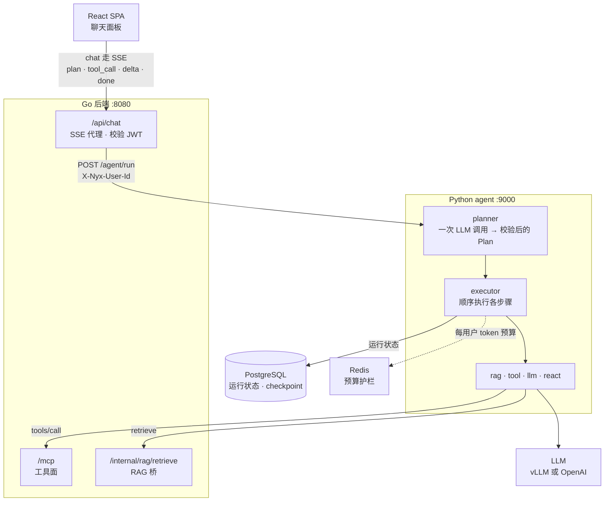

# nyx-agent

> 🌐 **English version**: [`README.md`](README.md)

**Nyx 的 Python Plan-and-Execute agent 服务。** 它把一次聊天请求变成类型化的执行计划，用工具逐步执行，并把每一步计划 / 每次工具调用 / 每个结果通过 SSE 实时推回聊天界面 —— 与 Go chat handler 的线上契约逐字节一致。



## 它做什么

- **Plan-and-Execute** —— planner 只做一次 LLM 调用（走 provider 结构化输出，Pydantic 校验，校验失败时有界重试），executor 然后按顺序执行各步骤。
- **步骤类型** —— `rag`（通过 Go RAG 桥读取你的 feed）、`tool`（MCP 工具面）、`llm`（单次调用）、`react`（模型 ↔ 工具嵌套循环，有迭代上限）。
- **默认就稳** —— 工具分发两类失败均有有界重试（校验失败重新提示 / 瞬时错误退避重试）、每用户 Redis token 预算（fail-closed）、按 IP 限流、运行状态存 Postgres 支持 `run_id` 恢复、僵尸运行清扫 + 保留期 GC。
- **可观测** —— Prometheus 指标（:9001）、OpenTelemetry 链路（Jaeger）、可选 Langfuse LLM 追踪。
- **可选 web 工具，默认关闭** —— agent 原生的 `web_search`（Tavily，无账号也可用 keyless 档）和带 SSRF 防护、非受信内容框定的 `web_fetch`。
- **记忆** —— 每个会话与消息都会持久化（保留期下限 1 年，软删除 + 宽限期）；planner 会注入跨会话的"已知用户偏好"块；面向主体的接口全部按 owner 限定：`/agent/sessions*`（历史侧边栏 API）与 GDPR 导出/擦除（`/agent/me/*`，审计仅记计数）。

## 端点

- `POST /agent/run` —— 入参 `{messages, agent?, model?, run_id?}`，出参 SSE（`plan`、`step_start`、`tool_call`、`tool_result`、`step_end`、`delta`、`done`、`note`、`error`、`terminator`）。
- `GET|POST|DELETE /agent/sessions*` —— 历史侧边栏 API（列表 / 回放 / 新建 / 恢复 / 删除），经 `X-Nyx-User-Id` 按 owner 限定。
- `GET /agent/me/export` · `DELETE /agent/me` —— GDPR 主体导出 + 物理擦除（幂等，含 langGraph 线程，审计仅记计数）；`PYTHON_AGENT_GDPR_ENABLED=false` 时两者均返回 503。
- `GET /healthz` —— Redis 可达时 `200 {"status":"ok"}`；否则 503。
- `GET /metrics` —— Prometheus 指标，端口 :9001。

## 本地运行

通常由仓库根目录的 `make dev` 拉起（需设 `AGENT_ENABLED=true`）。单独运行：

```bash
cd backend/agent_py
cp .env.example .env        # 填入 PYTHON_AGENT_LLM_BASE_URL + PYTHON_AGENT_LLM_API_KEY
pip install -e '.[dev]'
python -m agent.main        # 或：uvicorn agent.main:app --port 9000 --reload
```

需要 Postgres（启动时自动跑 alembic 迁移）和 Redis（预算护栏 —— Redis 不可达时运行会 fail-closed）。compose 里 `agent` 服务从本目录构建（`app` profile）。

## 测试

```bash
cd backend/agent_py && pytest tests/ -v
```

用 `fakeredis` + `httpx.MockTransport`，不需要真实网络。

## 关键环境变量

启动必需：

| 环境变量 | 默认值 | 用途 |
|---|---|---|
| `PYTHON_AGENT_LLM_BASE_URL` / `_API_KEY` / `_MODEL` | OpenAI / `gpt-4o-mini` | 任意 OpenAI 兼容端点（开发默认走 vLLM） |
| `PYTHON_AGENT_DATABASE_URL` | — | Postgres：`agent.runs` + langGraph checkpoint（启动跑 alembic） |
| `PYTHON_AGENT_REDIS_URL` | `redis://localhost:6380` | 每用户预算护栏 |
| `PYTHON_AGENT_MCP_URL` / `RAG_BRIDGE_URL` | `:8080` host-dev | Go 工具面 + RAG 桥 |
| `AGENT_BUDGET_PER_USER_PER_HOUR` | `200000` | 每用户每小时 token 上限（无前缀 —— 跨运行时的共享契约） |

常用开关：

| 环境变量 | 默认值 | 用途 |
|---|---|---|
| `PYTHON_AGENT_PLANNER_STRUCTURED_ENABLED` | `true` | `false` → 回退到旧的自由文本 plan 解析 |
| `PYTHON_AGENT_TOOL_RETRY_MAX` | `2` | 每次工具调用的重试上限（校验 + 瞬时两条路径） |
| `PYTHON_AGENT_WEB_FETCH_ENABLED` / `WEB_SEARCH_ENABLED` | `false` | agent 原生 web 工具；不带 `TAVILY_API_KEY` 时搜索走 keyless 档 |
| `PYTHON_AGENT_SWEEP_ENABLED` | `true` | 僵尸运行清扫的 kill switch |
| `PYTHON_AGENT_LANGFUSE_ENABLED` | `false` | 导出 LLM 级追踪到 Langfuse 实例 |
| `PYTHON_AGENT_CHAT_RETENTION_DAYS` / `…_GRACE_DAYS` | `365` / `7` | 聊天历史保留期（下限 365 天）+ 软删除宽限期 |
| `PYTHON_AGENT_PREFS_ENABLED` | `true` | 偏好抽取 + planner 注入的 kill switch |
| `PYTHON_AGENT_GDPR_ENABLED` | `true` | GDPR 导出/擦除 kill switch（503，不碰任何数据） |

全部开关、默认值与设计缘由 → [`README_ALL.md`](README_ALL.md)。

## 信任模型

本服务**不**校验 JWT。它运行在私有 compose / k8s 网络内 —— 9000 端口不对外发布，只有 `127.0.0.1:9001` 供指标抓取。Go 的 chat handler 在 SPA 边缘校验用户 JWT，并通过 `X-Nyx-User-Id` 头转发已验证的用户 id；bearer token 只是透传，由 Go 在 `/mcp` 与 RAG 桥上重新校验。`/agent/run` 上有进程内按 IP 限流（`PYTHON_AGENT_REQUESTS_PER_SECOND` 100 / `BURST` 200）作为防线纵深 —— 它**不是**鉴权层。若 9000 端口哪天暴露到这个网络之外，必须先加一层鉴权（mTLS / 共享密钥 / 防火墙）。完整论述 → [`README_ALL.md` § Trust model](README_ALL.md#trust-model)。

## 延伸阅读

- [`README_ALL.md`](README_ALL.md) —— 完整参考：planner 与工具重试的内部机制、prior-data 上下文限幅、清扫器 + 保留期、Langfuse、完整环境变量表、事故记录。
- [`FUTURE_AGENT.md`](../../FUTURE_AGENT.md) —— 路线图；[`docs/agent-deployment.md`](../../docs/agent-deployment.md) —— 生产上线文档。
- `openspec/changes/` —— 每个行为背后的变更提案。
